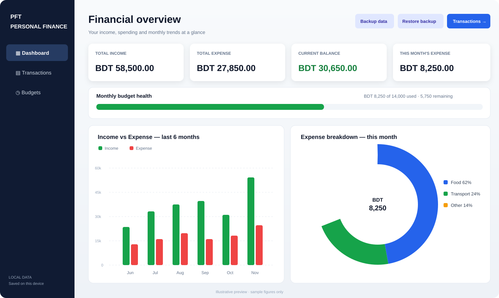
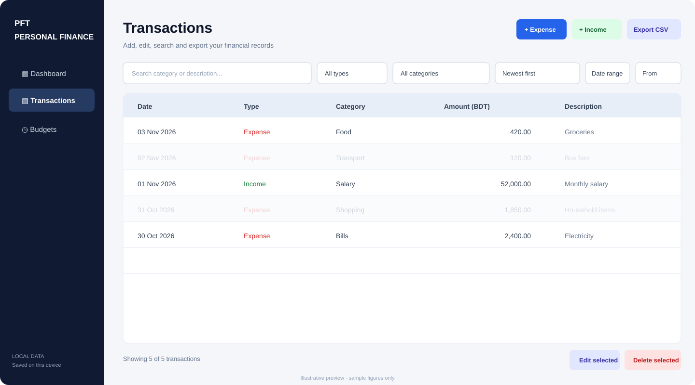
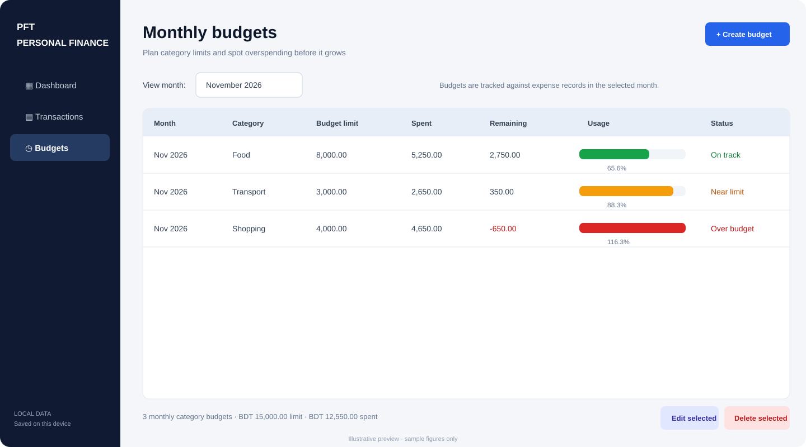
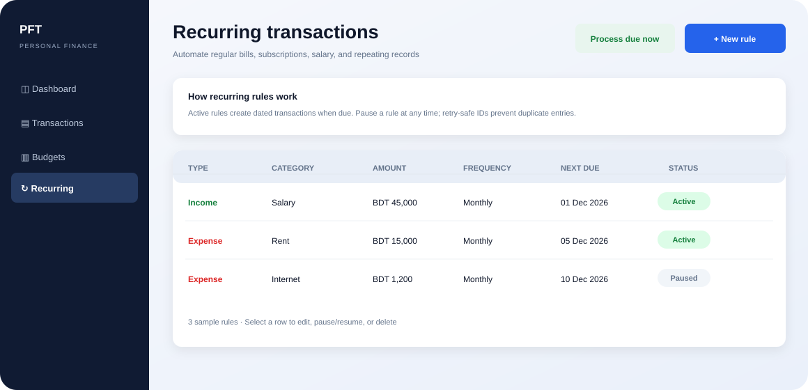

<div align="center">

# Personal Finance Tracker

<p>
  
</p>

**A polished, offline-first Windows desktop application for managing income, expenses, budgets, and financial trends.**


[Overview](#-overview) · [Features](#-features) · [Interface](#-interface-previews) · [Install](#-installation) · [Build](#-build-and-run) · [Testing](#-testing) · [Privacy](#-data-and-privacy) · [User guide](docs/USER_GUIDE.md)

</div>

---

## ✨ Overview

**Personal Finance Tracker** is a native Windows desktop application built with **C++17** and **Qt 6 Widgets**. It brings income, expenses, monthly category budgets, and financial analytics into one clean workspace.

The application works offline and stores your records locally as JSON files. No account, cloud service, remote database, or subscription is required.

> **Release:** `v3.0.0`
> **Display currency:** BDT (৳)
> **Target platform:** Windows 11 with the MSYS2 UCRT64 toolchain

## 🚀 Features

### 📊 Financial dashboard

- All-time **total income**, **total expenses**, and **current balance**.
- **This month's expenses** and aggregate monthly budget health.
- Six-month income-versus-expense bar chart.
- Current-month expense category donut chart.
- Budget usage progress with visual warning states.
- Dashboard figures and charts refresh after data changes.
- Subtle fade transitions between navigation pages and polished hover/focus states.

### 💳 Income and expense management

- Add, edit, and delete income and expense transactions.
- Store amount, date, category/source, and an optional description.
- Built-in categories plus editable custom category entry.
- Combined transaction history with clear income/expense indicators.
- Search by category or description.
- Filter by transaction type, category, and inclusive date range.
- Sort by newest, oldest, highest amount, or lowest amount.
- Clear all filters with one action.
- Double-click a transaction to edit it.
- Confirmation before permanent deletion.

### 🎯 Monthly category budgets

- Create a spending limit for a category and calendar month.
- Edit or remove a budget without changing transaction records.
- Compare the budget limit with actual expenses in that category and month.
- Review spent amount, remaining amount, and percentage used.
- Status indicators: **On track**, **Near limit** (80% or more), and **Over budget**.
- Prevent duplicate budgets for the same category and month.
- Dashboard-wide monthly budget progress summary.

### 🔁 Recurring transactions

- Create recurring income or expense rules for weekly, monthly, or yearly schedules.
- Choose category/source, amount, first due date, and optional description.
- Pause, resume, edit, or delete a rule at any time.
- Process due rules automatically when the application starts or manually from the Recurring page.
- Deterministic transaction IDs prevent duplicate generated records if processing is retried after an interrupted save.
- Each rule keeps its next due date, so future occurrences are not generated early.
- Monthly schedules preserve the selected day (or month-end anchor), including shorter months such as February.

### 📤 Export and recovery

- Export income and expense transactions to CSV.
- CSV uses UTF-8 with a BOM for improved spreadsheet compatibility.
- Text fields are quoted and spreadsheet formula-like values are neutralized.
- Create a complete JSON backup containing expenses, income, budgets, and recurring rules.
- Restore from a valid application backup after confirmation.
- Automatically create a pre-restore safety backup before replacing existing data.
- JSON writes use Qt `QSaveFile` to reduce the risk of partially written files.

### 💾 Local data and compatibility

- Expenses: `data/expenses.json`
- Income: `data/incomes.json`
- Budgets: `data/budgets.json`
- Recurring rules: `data/recurring.json`
- Existing Version 1 expense records remain readable; records without IDs receive generated IDs.
- Duplicate transaction IDs and duplicate category/month budgets are rejected.
- Malformed JSON is reported and is not silently overwritten.
- If the project data directory cannot be created, the app falls back to the operating system's application-data location.

## 🖼️ Interface previews

The illustrations below are **sample-data previews**. Replace them with fresh screenshots from your own build before publishing a public portfolio page. Never publish real personal financial records.

<p align="center">
  
</p>

<p align="center">
  
</p>

<p align="center">
  
</p>

<p align="center">
  
</p>

## 🧰 Technology stack

| Technology | Purpose |
|---|---|
| C++17 | Application logic and data models |
| Qt 6 Widgets | Native desktop interface and dialogs |
| Qt JSON classes | Local data serialization |
| Qt `QPainter` | Dashboard charts without an additional chart library |
| Qt `QSaveFile` | Safer atomic JSON and CSV writes |
| CMake | Multi-file project configuration |
| Ninja | Build generation |
| MSYS2 UCRT64 / MinGW-w64 | Windows compiler and toolchain |
| CTest | Automated model and storage checks |

**Chart dependency:** charts are drawn with `QPainter`; the optional Qt Charts module is not required.

## 🖥️ Installation

These instructions target **Windows 11** using **MSYS2 UCRT64**.

### 1. Install MSYS2

1. Download MSYS2 from the [official website](https://www.msys2.org/).
2. Install it to `C:\msys64` (the default location).
3. Open **MSYS2 UCRT64** from the Start menu. Do not use the plain MSYS terminal for this toolchain.

### 2. Update the package database

In MSYS2 UCRT64, run:

```bash
pacman -Syu
```

If MSYS2 asks you to close the terminal, close it, reopen **MSYS2 UCRT64**, and run the update command again if requested.

### 3. Install compiler, Qt, CMake, and Ninja

Run in **MSYS2 UCRT64**:

```bash
pacman -S --needed \
  mingw-w64-ucrt-x86_64-toolchain \
  mingw-w64-ucrt-x86_64-cmake \
  mingw-w64-ucrt-x86_64-ninja \
  mingw-w64-ucrt-x86_64-qt6-base
```

Accept the default package selection and confirm the installation.

### 4. Add UCRT64 to Windows PATH

Add this directory to your **Windows user Path**:

```text
C:\msys64\ucrt64\bin
```

Windows Search → **Edit environment variables for your account** → **Path** under User variables → **Edit** → **New** → paste the path → **OK**.

Close and reopen VS Code after changing PATH.

### 5. Verify the tools

Open a new VS Code PowerShell terminal and run:

```powershell
gcc --version
g++ --version
cmake --version
ninja --version
qmake6 --version
```

Each command should display a version.

### 6. Install VS Code extensions

Install these extensions from the VS Code Marketplace:

- **C/C++** — Microsoft
- **CMake Tools** — Microsoft

Open the folder that contains `CMakeLists.txt` as the VS Code workspace. Do not use Code Runner's **Run Code** command on an individual `.cpp` file; this is a multi-file Qt/CMake project.

## ▶️ Build and run

### Recommended: PowerShell helper scripts

Open VS Code's PowerShell terminal at the project root and run:

```powershell
.\scripts\build.ps1
.\scripts\run.ps1
```

The build helper configures a Release build, compiles the app and test target, and runs the automated tests. The run helper starts `build/ExpenseTracker.exe` and builds first if the executable is missing.

If PowerShell blocks local scripts, allow them for the current terminal session only:

```powershell
Set-ExecutionPolicy -Scope Process -ExecutionPolicy Bypass
.\scripts\build.ps1
.\scripts\run.ps1
```

### Manual CMake build

Make sure the terminal is at the **project root** (the folder containing `CMakeLists.txt`), not inside `src` or `include`.

```powershell
cmake -S . -B build -G Ninja -DCMAKE_BUILD_TYPE=Release -DCMAKE_PREFIX_PATH=C:/msys64/ucrt64
cmake --build build --parallel
ctest --test-dir build --output-on-failure
.\build\ExpenseTracker.exe
```

For a Debug build, replace `Release` with `Debug`.

### Build output

```text
build/ExpenseTracker.exe
```

## 🧪 Testing

The project includes a lightweight automated model/storage test executable, run through CTest. It checks:

- Budget validation and JSON round-trip.
- Budget storage read/write and duplicate category/month rejection.
- Legacy expense loading and automatic ID generation.
- Expense storage read/write.
- Income validation and storage read/write.
- Recurring-rule validation, schedule fields, JSON round-trip, and storage read/write.

Run tests with:

```powershell
ctest --test-dir build --output-on-failure
```

The GUI also needs manual testing. See [`tests/MANUAL_TEST_PLAN.md`](tests/MANUAL_TEST_PLAN.md) for the complete checklist.

## 🗂️ Project structure

```text
Personal-Expense-Tracker/
├── .vscode/settings.json
├── data/.gitkeep
├── docs/
│   ├── ARCHITECTURE.md
│   ├── MIGRATING_FROM_V2.md
│   ├── TROUBLESHOOTING.md
│   ├── USER_GUIDE.md
│   └── screenshots/
├── include/
│   ├── Budget.h
│   ├── BudgetStorage.h
│   ├── Expense.h
│   ├── ExpenseStorage.h
│   ├── Income.h
│   ├── IncomeStorage.h
│   ├── RecurringRule.h
│   ├── RecurringStorage.h
│   └── MainWindow.h
├── scripts/
│   ├── build.ps1
│   └── run.ps1
├── src/
│   ├── Budget.cpp
│   ├── BudgetStorage.cpp
│   ├── Expense.cpp
│   ├── ExpenseStorage.cpp
│   ├── Income.cpp
│   ├── IncomeStorage.cpp
│   ├── RecurringRule.cpp
│   ├── RecurringStorage.cpp
│   ├── MainWindow.cpp
│   └── main.cpp
├── tests/
│   ├── MANUAL_TEST_PLAN.md
│   └── model_storage_tests.cpp
├── .gitattributes
├── .gitignore
├── CHANGELOG.md
├── CMakeLists.txt
├── LICENSE
└── README.md
```

## 🔒 Data and privacy

- All records are stored locally on the device.
- No sign-up, telemetry, cloud sync, server, or database is used by the application.
- JSON records and backup files may contain sensitive financial information.
- Keep `data/*.json`, `data/backups/`, and CSV exports private.
- The `.gitignore` excludes local JSON records, backups, and generated build files.
- Use sample data in public screenshots and demonstrations.
- Back up your data before replacing project files or migrating to a new version.

## 🧱 Architecture

The application separates data models, persistence, and the Qt Widgets interface:

```text
MainWindow (Qt Widgets UI)
   ├── Expense model ── ExpenseStorage ── data/expenses.json
   ├── Income model  ── IncomeStorage  ── data/incomes.json
   ├── Budget model  ── BudgetStorage  ── data/budgets.json
   ├── Dashboard charts (QPainter)
   └── Backup / restore (versioned JSON bundle)
```

See [`docs/ARCHITECTURE.md`](docs/ARCHITECTURE.md) for additional detail.

## 🗺️ Roadmap

- [x] Income and expense CRUD
- [x] Local JSON persistence and legacy expense migration
- [x] Financial dashboard and charts
- [x] Search, filters, sorting, and CSV export
- [x] Monthly category budgets and overspending indicators
- [x] Full data backup and validated restore
- [x] Automated model/storage tests
- [ ] Scheduled / recurring transactions
- [ ] Optional dark theme and user preferences
- [ ] Optional Windows installer and portable release package

## 🤝 Contributing

Suggestions and bug reports are welcome. Before sharing a change, build the application, run CTest, and complete the relevant manual checks. Do not include personal transaction files, backup files, CSV exports, or build output in shared source packages.

## 📄 License

This project is distributed under the **MIT License**. See [`LICENSE`](LICENSE).

---

<div align="center">

**Built with C++17 and Qt 6.**
Track your money with clarity.

</div>
